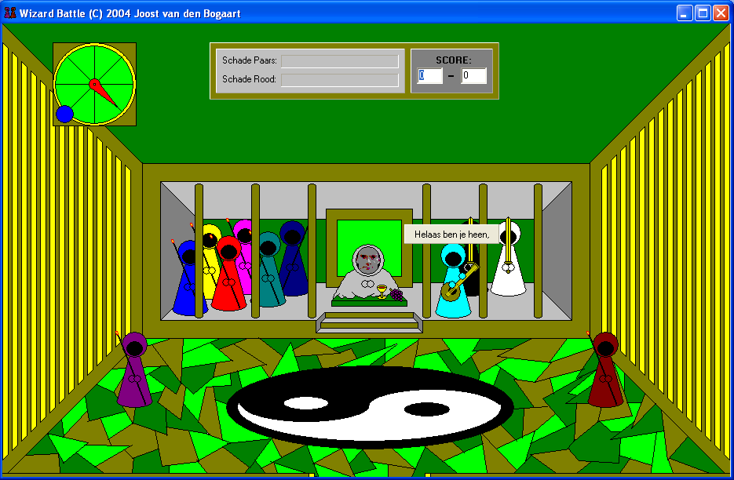

# Wizard Battle

Wizard Battle is one of [the games hosted by Richèl Bilderbeek](https://richelbilderbeek.github.io/games/).

Wizard Battle is a wizarding fighting game made by Joost van den Bogaart.

Wizard Battle is programmed in C++ using the IDE C++ Builder 6.0. It uses the VCL and Boost libraries.
The source code, however, has been lost.

## Screenshots

